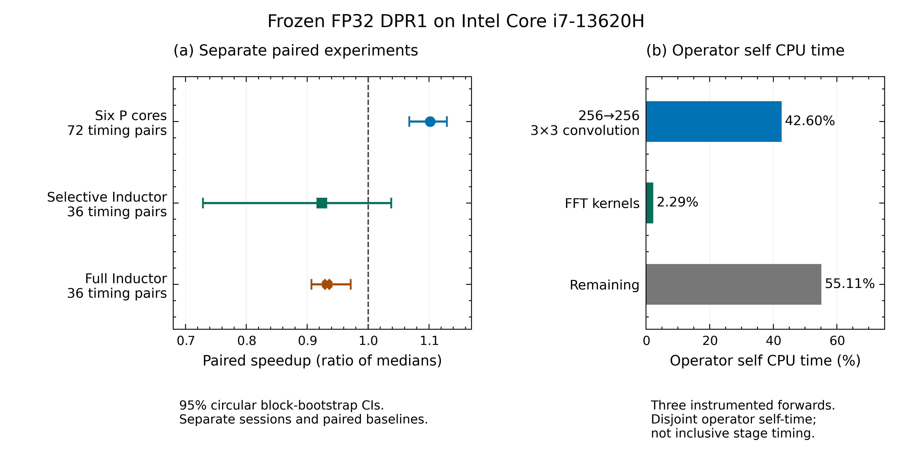

# DPR-CPU

DPR reconstructs a **64×64 physical-amplitude object** from **512×512 diffraction
intensity** and a valid-pixel detector mask. This fork preserves the original
[DPR](https://github.com/sungyun98/DPR) FP32 network, checkpoint and license notices.
The completed CPU study validates a machine-specific scheduling configuration;
the portable default remains four intra-op threads and one inter-op thread.

## Key results

| Completed finding | Audited result |
| --- | --- |
| Model | Original frozen FP32 DPR1; unchanged pretrained checkpoint |
| Validated configuration | Intel Core i7-13620H, six intra-op / one inter-op, verified P-core-only affinity |
| 72-pair confirmation median / p95 | **0.705110 / 0.879230 s** |
| Same-session paired reference median | 0.777050 s; four threads, inherited affinity |
| Paired speedup, 95% CI | **1.102026× [1.067681, 1.129598]** |
| Fidelity | Strict numerical and reconstruction-change gates passed on 18 development measurements / seven objects; five selection-locked replay examples passed |
| Main operator bottleneck | Repeated 256→256 3×3 convolution: 42.60% of operator self CPU time; FFT kernels: 2.29% |
| Selective Inductor, later session | 0.92403× [0.72867, 1.03813]; quality passed, no detectable speedup |
| Full Inductor, later warm-cache session | 0.93262× [0.90681, 0.97152]; slower, strict parity failed on two measurements / 11 pixels |
| Local convolution prototypes | All four slower than native; tile-16 alone passed strict FP32 operator parity; no new backend promoted |

These are prepared-network timings, excluding loading, I/O, RPC, compiler startup,
quality scoring and optional iterative refinement. Every ratio uses its own paired
reference. Separate sessions are **not a controlled cross-session ranking**. A
1.102026× speedup corresponds to about 9.26% lower median latency. Historical
four-thread measurements (0.782155 s median, 0.959490 s p95) belong to the earlier
study and are never a denominator for the newer trials.

## Scientific figure



**CPU update.** (a) Ratio of paired-arm medians, 95% circular moving-block bootstrap
intervals (5,000 draws, six-pair blocks). Timing pairs are repeated calls, not
independent objects. The dashed line denotes 1×. Six P cores is the accepted
configuration; selective compilation has no detectable gain; full compilation
fails numerical parity. (b) Disjoint **operator self CPU time** over three profiled
forwards. Inclusive stage timings use a different denominator.
[Vector PDF](cpu_study/figure_cpu_update.pdf) · [Exact plotting table](cpu_study/cpu_update_results.csv) ·
[Source hashes and boundaries](cpu_study/evidence/manifest.json).

The original [main figure](cpu_study/figure_main.png),
[main PDF](cpu_study/figure_main.pdf), [diagnostics](cpu_study/figure_diagnostics.png)
and [diagnostics PDF](cpu_study/figure_diagnostics.pdf) remain available. Their
four-thread conclusions describe the earlier study; the table above supersedes
its configuration-selection conclusion.

## How DPR works

The network masks and normalizes intensity, uses a weighted partial convolution
encoder, fast Fourier convolution and merging, modulus projection, learned
refinement, and physical-flux scaling. `True` means a valid detector pixel.
`false_scale=False` returns physical amplitude. Changing scheduling leaves this
model and task unchanged.


The preserved GIF loops infinitely through five archived cases, two seconds each.
Truth and reconstruction share a fixed global gamma-0.5 physical-amplitude mapping;
detector display uses shared log-intensity limits. It animates cases, not model
iterations. Original failures remain visible.

## Installation

Use Python 3.12. Clone the default branch, create an environment, then activate it
(`.venv\Scripts\Activate.ps1` in PowerShell; `source .venv/bin/activate` on Unix).

```bash
git clone https://github.com/KindlyGentleman/DPR-CPU.git
cd DPR-CPU
python -m venv .venv
```

After activation, install the tested CPU runtime and pinned shared dependency:

```bash
python -m pip install torch==2.5.1 torchvision==0.20.1 --index-url https://download.pytorch.org/whl/cpu
python -m pip install numpy==1.26.4 scipy==1.13.1
python -m pip install "phaseretrieval @ git+https://github.com/sungyun98/PhaseRetrieval.git@e844e4655af899b0bce5464cbfd32206962e977d"
python -m pip install -e ".[cpu-study,cpu-optimization,test]"
```

The original `requirements.txt`/`environment.yml` are upstream environments, not
the pinned CPU study recipe. Training, data generation, the [demo](demo.ipynb) and
[upstream regression instructions](tests/regression/README.md) are preserved.

## CPU inference

Run in a fresh process from the repository root. The packaged `DPRCPU` API checks
the checkpoint hash, validates finite inputs and returns an owned FP32 array.

```python
import numpy as np
from cpu_optimization import DPRCPU

model = DPRCPU.from_pretrained(backend="reference", threads=4)
with np.load("cpu_study/examples.npz", allow_pickle=False) as saved:
    amplitude = model.predict(saved["intensity_0"], saved["valid_0"])
assert amplitude.shape == (64, 64)
```

On the tested topology, `threads=6, affinity=list(range(12))` selects the measured
P-core configuration. Discover and verify topology on another machine before
using affinity IDs. See [CPU API and settings](cpu_optimization/README.md).

## Reproduce the results

```bash
python cpu_study/reproduce.py --all
python cpu_study/plot.py --figure main
python cpu_study/plot.py --figure diagnostics
python cpu_study/animate.py
python cpu_study/plot_cpu_update.py
python -m pytest cpu_optimization/tests tests/test_cpu_study.py tests/test_publication.py tests/test_cache_cleanup.py -q
python scripts/release_audit.py --verify --output build/release-audit
```

The new figure checks hashes and replays paired statistics from compact committed
records without benchmarks. The original plotting/animation commands use genuine
archived arrays; the inference command checks five fresh reconstructions. Full
historical detector populations and compiler execution trees are not distributed.
Summary CSVs cannot recreate missing detector arrays. See [scientific report and
evidence scope](docs/CPU_RESULTS.md), [release verification](docs/RELEASE_VERIFICATION.md)
and [developer maintenance](docs/MAINTENANCE.md).

## Scientific limitations

Scheduling improved measured latency; these experiments do not isolate a causal
hardware mechanism. Native compilation executing successfully did not establish
speed or quality. Numerical parity means reproducing the frozen model within
`rtol=1e-4, atol=1e-5`; it does not establish agreement with truth. The original
570-measurement historical study had 251 NRMSE>0.5 failures, and scheduling does
not correct them. Timing repeats do not enlarge the seven-object development set.
Results are machine/session-specific and synthetic examples do not establish
experimental validity. The unchanged inherited `network_synthetic` test exceeds
its original 1e-5 relative-L2 tolerance; scoped passing tests are reported separately.

## Citation and license

Please cite Lee et al., *npj Computational Materials* **11**, 68 (2025),
[Deep-learning real-time phase retrieval of imperfect diffraction patterns from
X-ray free-electron lasers](https://doi.org/10.1038/s41524-025-01569-7).
[BibTeX, PhaseRetrieval references and all original license notices](docs/CITATION_AND_LICENSE.md).
The repository retains [BSD 2-Clause](LICENSE.txt), [NVIDIA BSD 3-Clause](LICENSES/partialconv-BSD-3-Clause.txt)
and [Apache 2.0](LICENSES/FFC-Apache-2.0.txt) notices; see the linked attribution table
for exact file-specific terms.
