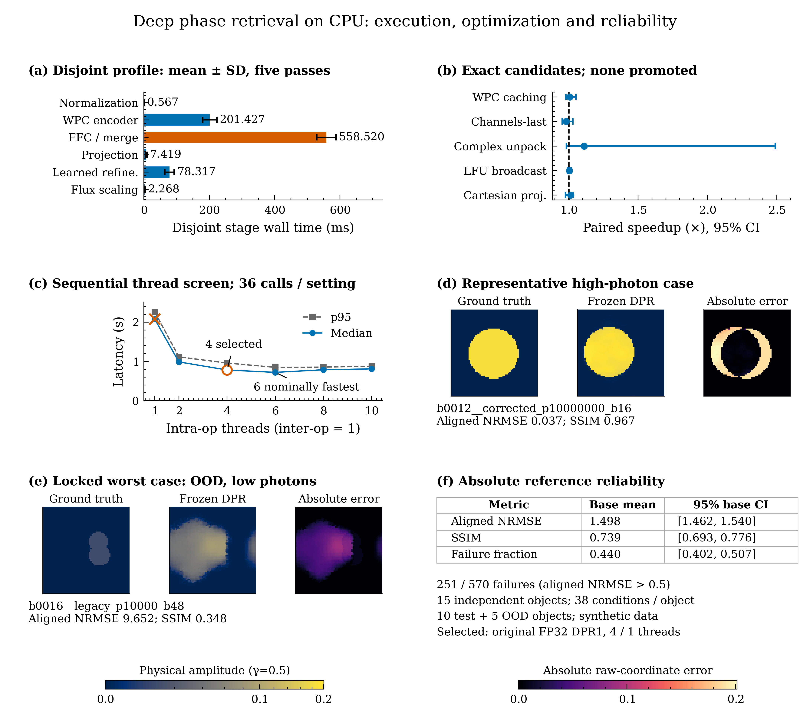
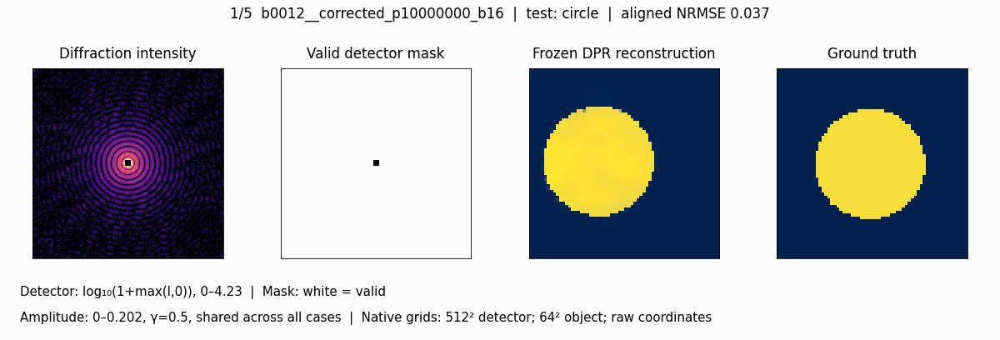

# DPR-CPU

Deep Phase Retrieval (DPR) reconstructs a **64×64 physical-amplitude object** from a
**512×512 diffraction-intensity pattern** and its valid-pixel mask. This fork of
[Sung Yun Lee et al.'s DPR](https://github.com/sungyun98/DPR) preserves the original
implementation and pretrained DPR1 checkpoint, and presents a completed CPU optimization
study. **The original FP32 PyTorch model remains the selected exact and practical CPU
deployment. No tested alternative qualified for promotion.**

## Method

The CPU pipeline masks and normalizes intensity, encodes it with weighted partial
convolutions (WPC), applies fast Fourier convolution (FFC) and merging layers, projects
the measured Fourier modulus, performs learned refinement, and restores physical flux.
`True` means a valid detector pixel; `false_scale=False` returns physical amplitude.
The checkpoint is unchanged (SHA-256 below).

The baseline uses four intra-op and one inter-op thread, FP32 and persistent model reuse.
Five exact candidates used matched inputs, ten warmups and 36 randomized timing pairs
each, following fidelity checks on 18 measurements from seven development objects.
Timing intervals use a paired circular moving-block bootstrap (2,000 draws, six-pair
blocks). Promotion required ≥10% median latency reduction, a CI supporting improvement,
≤5% p95 increase, numerical equivalence (`rtol=1e-4`, `atol=1e-5`), per-case NRMSE
increase and SSIM loss ≤1e-4, no new failures, and acceptable resource evidence.
Selection was locked before the final 570-measurement reference replay.

## Results



**Figure 1.** (a) Disjoint diagnostic stage means ± sample SD over five bitwise-checked
manual forwards; these are not the warmed deployment median, and nested FourierUnit
times are not added. (b) WPC caching, channels-last layout, complex unpack, LFU broadcast
and Cartesian projection: paired ratios of medians with stored 95% block-bootstrap CIs.
The complete broad complex-unpack interval retains an unresolved slow period; every CI
crosses 1×. (c) Sequential fresh-process thread screens, ten warmups/36 calls each;
p95 is an empirical percentile, not uncertainty. The × marks the one-thread numerical
gate failure. Six threads was nominally faster but its unpaired screen did not establish
promotion; four is the selected configuration for this study. (d) Prespecified
high-photon example. (e) The locked maximum-NRMSE case, an OOD multiple object at
10⁴ photons with a 48-pixel beamstop. Images are native 64² arrays in raw coordinates,
without registration or amplitude fitting: truth/reconstruction share one global
gamma-0.5 amplitude mapping, and absolute raw-coordinate errors share a linear scale.
The displayed metrics instead use evaluation alignment (integer translation/inversion,
including outside-window energy, without amplitude fitting). (f) Equal-base-weighted
means and 95% percentile CIs resampling **15 independent base objects**, each with
38 conditions (10 test objects, five OOD). The 570 rows are dependent measurements.
[Vector PDF](cpu_study/figure_main.pdf).

| Historical measurement | Original FP32 DPR1 |
| --- | ---: |
| CPU / configuration | Intel Core i7-13620H; 4 intra-op / 1 inter-op |
| Prepared-network median / p95 | 0.782155 / 0.959490 s |
| Serial batch-one throughput (reciprocal median) | 1.2785 samples/s |
| Single-model Windows lifetime peak working set | 0.840 GiB |
| Final measurements / independent objects | 570 / 15 |
| Original failures: aligned NRMSE >0.5 | 251/570 (44.0%) |
| Accepted alternative | None |

Prepared-network timing excludes checkpoint loading, input I/O, array conversion,
serialization, optional iterative refinement and offline quality evaluation. These
machine/session-specific historical results used Windows 11 and PyTorch 2.5.1+cpu.
The final reference replay reproduced identical outputs; its timings are not an
acceleration result. This study does not correct the original morphology failures.

## Technical analysis

[Figure 2 (PNG)](cpu_study/figure_diagnostics.png) · [Vector PDF](cpu_study/figure_diagnostics.pdf)

**Figure 2.** (a) Completed four-thread real FFT cohorts at three representative DPR
shapes: forward/inverse medians with empirical p5–p95 whiskers (not CIs); open markers
are prepared native calls, filled markers include the Torch bridge. Feature transforms
use `ortho`, detector transforms `backward` normalization. NumPy native arithmetic is
float64/complex128; its bridge casts back to FP32/complex64. The × marks ORT's
detector-forward bridge parity failure. Cohorts were sequential with 5–300 adaptive
repetitions; kernel timings do not establish network speedups. (b) Rejected grouped
INT8 variants: median PSNR losses 1.644/4.444 dB and SSIM losses 0.06494/0.32031
(spectral/spatial 1×1), evaluated on 18 development measurements from seven objects.
The two metrics have separate axes. (c) Genuine saved outputs for the fixed low-photon,
large-beamstop development case `b0006__corrected_p10000_b48`; all four native 64²
images share one gamma-0.5 amplitude scale, without alignment or fitting.

FFC/merge and WPC dominate the disjoint profile. Other completed negative tests include
Conv–BN fusion and full OpenVINO FP32 execution, both rejected by the strict numerical
gate (maximum amplitude differences 2.18e-5 and 3.24e-5). A two-thread GPS-R refinement
change produced a 0.939× complete-pipeline speed ratio [0.908, 1.001], on three
development measurements from two independent objects, and was not promoted.
Grouped INT8 results are development-only; no quantized end-to-end CPU speed is inferred.

## Reconstruction



Five genuine synthetic cases from the locked evaluation, two seconds per case, loop
indefinitely. Detector display uses `log10(1+max(I,0))` with shared limits; signed input
arrays are retained. White mask pixels are valid. Reconstructions/truth share one global
gamma-0.5 amplitude scale across all frames. Rendering uses nearest neighbors, no
interpolation between cases, no model-iteration animation. Some original reconstructions
fail badly on difficult inputs; these synthetic examples do not establish experimental validity.

## Installation

Use Python 3.12 and a virtual environment. Clone this fork, then activate the environment
(`.venv\Scripts\Activate.ps1` in PowerShell; `source .venv/bin/activate` on Linux/macOS).

```bash
git clone https://github.com/KindlyGentleman/DPR-CPU.git
cd DPR-CPU
git switch feat/minimal-cpu-research
python -m venv .venv
```

After activation, install the CPU build and the original package with small plotting extras:

```bash
python -m pip install torch==2.5.1 torchvision==0.20.1 --index-url https://download.pytorch.org/whl/cpu
python -m pip install numpy==1.26.4 scipy==1.13.1
python -m pip install "phaseretrieval @ git+https://github.com/sungyun98/PhaseRetrieval.git@e844e4655af899b0bce5464cbfd32206962e977d"
python -m pip install -e ".[cpu-study,test]"
```

Upstream `requirements.txt` and `environment.yml` remain available. The upstream
[demo notebook](demo.ipynb) includes the experimental pattern and optional GPS-R
refinement. [Training](train.py), [data generation](generate_dataset.py) and
[regression instructions](tests/regression/README.md) are retained. The current package
is `deeppr`; the original `module` API remains in upstream tag `v1.0-legacy`.

## Reproduction

Run from the repository root, in a fresh Python process:

```bash
python cpu_study/reproduce.py --all
python cpu_study/plot.py --figure main
python cpu_study/plot.py --figure diagnostics
python cpu_study/animate.py
python -m pytest tests/test_cpu_study.py -q
```

`reproduce.py` loads the unchanged checkpoint on CPU and checks fresh outputs against
the archived examples. `--case 0` runs one case; `--output cpu_study/inference.npz`
saves fresh outputs separately. These first-use calls are demonstrations, not warmed
historical benchmarks. Plotting requires no model execution. Both figures load
**SciencePlots `science`, `ieee`, `no-latex`**, use 7.16-inch canvases, and export
600-dpi PNG plus PDF with embedded TrueType fonts. Array images retain native sampling;
chart elements and text are vector in the PDF.

Checkpoint SHA-256: `823572aa0c4bc973acf149734b79833cb9fccf708aad23426373b8c62b5dc379`.

## Reproducibility boundaries

Included [summary values](cpu_study/results.csv), [paired timing rows](cpu_study/paired_timings.csv),
[570 reference metric rows](cpu_study/final_metrics.csv), [native example arrays](cpu_study/examples.npz)
and [source hashes, environment and transformations](cpu_study/provenance.json) regenerate
the figures/GIF and permit replay of the paired timing and independent-base CIs.
`results.csv` uses `low/high` for stage mean±SD, candidate/reliability 95% CIs, or FFT
p5–p95 according to `section`; blank bounds mean no interval is supplied.

The complete historical study's raw manifests, all prediction arrays and alternative
implementations are outside this minimal repository. The included subset supports
reconstruction demonstrations and evidence inspection; it does not independently
reproduce the full 570-measurement experiment or establish portability of its timings.

Validation: all five included inputs replay bitwise under PyTorch 2.5.1+cpu, and all
eleven study checks pass. The upstream `network_synthetic` legacy-reference test exceeds
its 1e-5 relative-L2 tolerance (1.802e-5 / 1.866e-5); the same failure reproduces on
unchanged upstream source. Its tolerance is preserved. The complete suite reports
25 passed, 5 skipped, 4 expected failures and this one pre-existing failure.

## Citation

When using DPR or weighted partial convolution, please cite:

> S. Y. Lee, D. H. Cho, C. Jung, D. Sung, D. Nam, S. Kim, and C. Song, Deep-learning real-time
> phase retrieval of imperfect diffraction patterns from X-ray free-electron lasers,
> *npj Comput. Mater.* **11**, 68 (2025). <https://doi.org/10.1038/s41524-025-01569-7>

```bibtex
@article{lee2025npjcompumats,
  title   = {Deep-learning real-time phase retrieval of imperfect diffraction patterns from X-ray free-electron lasers},
  author  = {Lee, Sung Yun and Cho, Do Hyung and Jung, Chulho and Sung, Daeho and Nam, Daewoong and Kim, Sangsoo and Song, Changyong},
  journal = {npj Computational Materials},
  volume  = {11},
  pages   = {68},
  year    = {2025},
  doi     = {10.1038/s41524-025-01569-7}
}
```

For the phase retrieval algorithms, please also cite the references of
[PhaseRetrieval](https://github.com/sungyun98/PhaseRetrieval).


Scientific visualization/review workflow guidance: Kassis, Agarwal, He, Patel and Brueckner
(2026), [Scientific Agent Skills](https://doi.org/10.48550/arXiv.2609.00065).

## License

This code is released under the BSD 2-Clause License (`LICENSE.txt`), except for the
third-party code below, which keeps its original license (full text in `LICENSES/`); the
changes made are stated at the top of each file.

| File | Source | License |
|---|---|---|
| `deeppr/weightedpartialconv2d.py` | derived from [NVIDIA/partialconv](https://github.com/NVIDIA/partialconv) `models/partialconv2d.py` | BSD 3-Clause, Copyright (c) 2018 NVIDIA Corporation |
| `deeppr/loss.py` (`VGG19Partial`, `gram_matrix`) | adapted from [NVIDIA/partialconv](https://github.com/NVIDIA/partialconv) `models/loss.py` | BSD 3-Clause, Copyright (c) 2019 NVIDIA Corporation |
| `deeppr/ffc.py` (FFC layers) | modified from [pkumivision/FFC](https://github.com/pkumivision/FFC) `model_zoo/ffc.py` | Apache 2.0, Copyright 2022 Lu Chi |
| `deeppr/ffc.py` (`FFCResNetBlock`, `ConcatTupleLayer`) | modified from [advimman/lama](https://github.com/advimman/lama) `saicinpainting/training/modules/ffc.py` | Apache 2.0, Copyright 2021 Samsung Research |
| `deeppr/asam.py` | copied from SamsungLabs/ASAM `asam.py` (repository no longer online; [Software Heritage archive](https://archive.softwareheritage.org/swh:1:rev:f156a680171db16d551c0d85cba2514fa3bff6a2)) | Apache 2.0, Copyright 2021 Samsung Research |

The pretrained VGG19 weights used by the perceptual loss are downloaded by torchvision at run
time and are not distributed with this repository.
